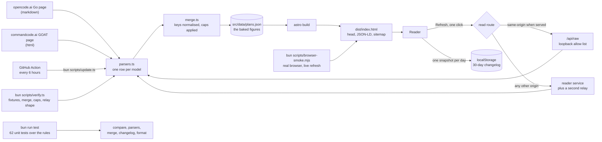

# Kodeverse: what a ten-dollar coding plan gets you

OpenCode Go and Command Code GOAT compared model by model. Both cost ten
dollars a month. Every figure is read from the vendor pages and stamped with
the date it was read.

The page is a static Astro build. The [method](#how-the-numbers-are-read), the
[findings](#the-short-answer) and the engineering notes are below. To run it:
`bun run build` then `bun run serve`, and open http://127.0.0.1:8787.

## The question

Same price. Do the two plans give the same usable allowance, and if not, which
one gives more on the models I actually use?

## The short answer

- They differ. Across the 26 models both plans publish an allowance for,
  Command Code GOAT leads on 14 models, OpenCode Go leads on 9, and 3 are level.
- The plans cap differently. OpenCode Go derives each window from the model's
  own monthly limit: 20% for five hours, 50% for a week. Command Code GOAT
  states flat caps: $14 for five hours and $35 for a week, on every model.
- Token prices barely differ. Where they do, the comparison shows both rates
  per model, so the rest of the comparison is allowance alone.
- The best case is the same on both plans: $80 of monthly credit on one model.
  The five-hour cap is the number a user actually meets, and that is where the
  plans part company.
- The widest single gap is $40 of monthly credit, on MiMo-V2.6-Flash and on the
  Muse Spark contributor models.

Figures as read on the date stamped in the footer of the page. The vendors move
their pages without notice, so treat the plan pages as the contract and this
document as a dated reading of them.

## How the numbers are read

1. Both vendor pages are read directly. OpenCode answers markdown when asked,
   which is the smaller and easier parse. Command Code publishes HTML tables.
2. Each catalogue is parsed into one row per model: four token rates, a monthly
   credit, the vendor's own request estimates per window, and any promotion
   printed beside the rate.
3. The two catalogues are merged on a normalised model key. The key strips the
   vendor's own formatting, so "Tencent Hy4 Preview" and "Hy4 preview" are one
   model. The cheapest tier listed for a key wins, so off-peak and smaller
   context variants do not double-count.
4. Caps are applied per plan, read from the plan's own rule. A flat cap is the
   smaller of the allowance and the cap. A derived cap is the model limit times
   the share. An unlimited allowance keeps unlimited caps.
5. A model is comparable only when both plans publish the figure on screen.
   A model one plan merely carries has nothing to compare, so it stays out of
   the table instead of arriving as a row of dashes. 26 of the 64 catalogued
   models are comparable.

## The pipeline



## Why a static page, a refresh button, and a scheduled read

- Nothing to read needs a server. The page is a static build with the figures
  baked in at build time.
- Refresh is one click, and the read does not depend on any one server. When
  the page is served by `bun run serve`, the read goes to a same-origin route
  that is loopback-only and fixed to an allow list, so no third party is in the
  loop. From any other origin the read falls back to public readers: Command
  Code is read directly because it sends `Access-Control-Allow-Origin`, and
  opencode.ai, which sends none, is read through a reader service that echoes
  the origin back.
- The scheduled read needs no relay at all. `.github/workflows/refresh.yml`
  runs `bun scripts/update.ts` every six hours, writes the figures, and commits
  when anything moved. A deployment that rebuilds on push is then never more
  than six hours stale, and the footer states the exact read date regardless.
- A refresh fails closed. A reply that comes back missing a plan, missing most
  of the catalogue, or with too few comparable models is refused, and the
  figures on screen stay the ones the last build read.
- Every refresh is audit-logged. The page keeps one snapshot per day for thirty
  days in the browser and diffs the live figures against the most recent day.
  The log is a dialog behind a nav icon, not a section: a reader opens it when
  they wonder what moved, and it never takes a place in the page's argument.

## Page metadata and SEO

The head is built once in `src/layouts/main.astro`, from one identity block, so
the tags, the JSON-LD and the sitemap cannot disagree.

- Title, description, keywords, authors, creator and publisher.
- `metadataBase` and a canonical url, with `hreflang` alternates for the
  default and English locales.
- Open Graph complete: type, site name, locale, title, description, url, and a
  image with type, width, height and alt text. Twitter uses the same card.
- Icons: `brand.webp` as the favicon and the apple touch icon, plus a web
  manifest.
- Robots: indexable, followed, full-size image previews, in the head and in
  `robots.txt`.
- schema.org structured data as JSON-LD: Organization, WebSite, WebPage and a
  Dataset whose `dateModified` is the same read stamp the footer shows.
- `sitemap.xml` with a `lastmod` from that stamp.

Absolute urls come from one environment variable. Set it before building:

```
SITE_URL=https://your-domain bun run build
```

Without it the build still succeeds, and the head omits only the absolute urls.
Cabinet Grotesk is self-hosted in `public/fonts`, so no font is fetched from a
third party at read time.

## How correctness is checked

Three layers, from the cheapest to the closest to the reader.

- `bun run test` is the unit gate. 62 tests over the pure library: the
  comparison rules (who leads, by how much, what a tie is, which models are
  comparable), the cell readers and both vendor parsers, the merge and its cap
  rules, the refresh guard, the changelog diff and history window, and the
  display formatting. Every expected value is a literal.
- `bun run verify` is the data gate. It checks the baked data, both parsers
  against the saved vendor fixtures, the merge and its cap rules, the changelog
  diff, and the shape of the relay. A truncated read must still parse whole.
- `bun run smoke` drives the built page in a real browser against the local
  server. It exercises the filter, both comparison dimensions, paging, the
  theme, and a live refresh, and it fails on any uncaught page error.
- `.github/workflows/verify.yml` runs lint, format, types, tests, build and the
  gate on every push.
- Numbers are never invented. Every figure on the page comes from the vendor
  pages, and the read date sits in the footer.

## Layout

```
src/
  data/plans.json     the baked figures: scripts/update.ts writes, the page reads
  lib/                parsers, merge, comparison rules, changelog, refresh, format
  components/compare/ one file per section, plus the shared bits and view state
  components/ui/      shadcn components
  pages/index.astro   the page
  pages/robots.txt.ts and sitemap.xml.ts, built from the same read stamp
  layouts/main.astro  the shell: head, mark sprite, theme bootstrap, toaster
scripts/
  update.ts           fetch both vendor docs, parse, write src/data/plans.json
  serve.mjs           serve dist/ and the read proxy at http://127.0.0.1:8787
  verify.ts           the gate: data, parsers, merge, changelog, serve contract
  browser-smoke.mjs   drive the built page in a real browser
vendor/               the two vendor pages, kept as fixtures for verify.ts
.github/workflows/
  refresh.yml         scheduled read: every six hours, commit when a figure moves
  verify.yml          lint, format, types, build and the gate on every push
```

## Commands

```
bun install
bun run update      # re-read both vendors, rewrite src/data/plans.json
bun run build       # static build to dist/
bun run serve       # http://127.0.0.1:8787 with the read proxy
bun run dev         # astro dev
bun run lint        # oxlint
bun run fmt         # oxfmt
bun run check       # lint + fmt:check
bun run typecheck   # astro check
bun run test        # vitest, the unit gate
bun run verify      # the gate (needs a build in dist/)
bun run smoke       # browser smoke against a running serve.mjs
```

## Known limits

- Request estimates are each vendor's own. The vendors assume different tokens
  per request, so a request column is read on its own and never summed across
  plans as if the units matched.
- A refresh reads the pages the allow list names. A vendor that moves a plan to
  a new url stops being read until the list is updated.
- The figures are as current as the last read. The footer states that date and
  warns once the reading is more than six hours old.
- No translated variant exists, so the only `hreflang` alternates are the
  default and English.
